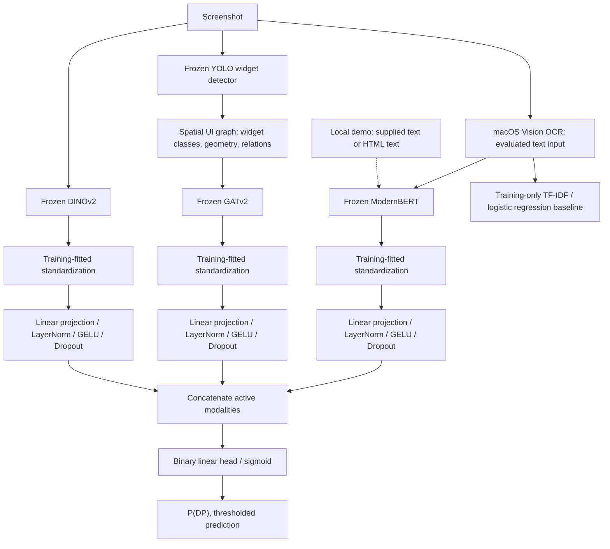

# Multimodal Dark Pattern Detection

Detect potentially deceptive interface designs from screenshot pixels, text and
UI layout using PyTorch. The task is binary screenshot classification:
`DARK PATTERN` versus `NO DP`. A screenshot can show visual or linguistic cues,
but it cannot establish deceptive intent or interaction-dependent behavior.

This repo contains a reproducible **pilot on an identifiable web subset**.
In the recorded run, graph-only achieved higher F1 than full fusion. The
results below include weak and zero-F1 outcomes; they do not establish
production readiness or generalization to unseen encoder-pretraining sites.

## Demo

- [Hosted Gradio screenshot demo](https://huggingface.co/spaces/sai-Rohan/Dark_Pattern_Detection_API).
  The public Space's runtime was sleeping when checked. It is a separately
  hosted application; the table below measures this repo's local experiment.
- [Local screenshot + text/HTML demo](docs/inference.md): verified CLI inference
  with an exported seeded head. It returns prediction and uncalibrated
  confidence JSON. DOM input supplies text; graph geometry comes from detected
  screenshot widgets.
- [Deployed encoder weights](https://huggingface.co/sai-Rohan/Dark_pattern_Detection_models),
  pinned for the recorded experiment to `857a8bf57ffa4b8b809daa85a90a536b04a3302c`.

## Architecture



The encoders stay frozen. Each modality combination trains fresh projections
and a classifier; excluded branches are absent. The evaluated fusion is
concatenation, with a projection dimension of 64.
This run does not measure end-to-end fine tuning or reproduce the existing
hosted fusion classifier. See [the evaluation protocol](docs/evaluation.md).

## Dataset

The local data is an AIDUI/ContextDP derivative audited from image files and
annotations, with upstream lineage described in [SageSELab/AidUI](https://github.com/SageSELab/AidUI).
A screenshot is positive if any supplied region annotation is DP-positive.

| Local corpus | Screenshots | DP-positive | Negative |
| --- | ---: | ---: | ---: |
| Mobile | 339 | 175 | 164 |
| Web | 162 | 83 | 79 |
| Total | 501 | 258 | 243 |

There are 546 region annotations, including 303 positive instances.
Region counts are not screenshot counts. The local files contain duplicate
images. In the supplied historical manifest, 6 identifiable sites occur in
multiple splits, and an identical image occurs in both train and test. That
historical split is excluded from the reported experiment.

The corrected split uses 155 web screenshots from 138 filename-identifiable site
groups. It groups registrable domains and joins decoded-identical images
before splitting. Within this subset, checks found no shared sites or exact
images across splits.

| Evaluated split | Screenshots | DP-positive | Negative |
| --- | ---: | ---: | ---: |
| Train | 108 | 50 | 58 |
| Val | 24 | 16 | 8 |
| Test | 23 | 10 | 13 |

The remaining 346 screenshots are excluded: all mobile samples and web samples
without reliable source identities. Full app-safe splitting remains incomplete.
The local screenshot license, upstream download version and annotation
adjudication history are not fully verified. See the [dataset audit](docs/dataset.md)
and [script-generated counts and hashes](docs/dataset_audit.json).

## Recorded results

All comparisons use the same held-out 23 screenshots, the same fixed split and
seeds 42, 43, 44. Values are mean ± **sample** standard deviation over
3 training seeds. The positive class is DP. Precision, recall and F1 are
positive-class scores; ROC-AUC and PR-AUC use probabilities. PR-AUC uses
trapezoidal integration, not average precision.

| Variant | Accuracy | Precision | Recall | F1 | ROC-AUC | PR-AUC |
| --- | ---: | ---: | ---: | ---: | ---: | ---: |
| Visual only | 0.4783 ± 0.0000 | 0.0000 ± 0.0000 | 0.0000 ± 0.0000 | 0.0000 ± 0.0000 | 0.4359 ± 0.0160 | 0.3632 ± 0.0102 |
| Text only | 0.5507 ± 0.0905 | 0.4306 ± 0.1684 | 0.2667 ± 0.2082 | 0.3198 ± 0.2098 | 0.5641 ± 0.1195 | 0.4391 ± 0.0672 |
| Graph only | 0.5797 ± 0.0664 | 0.5222 ± 0.0694 | 0.6333 ± 0.0577 | 0.5685 ± 0.0282 | 0.6410 ± 0.0160 | 0.5812 ± 0.0278 |
| Visual + text | 0.5217 ± 0.0435 | 0.2778 ± 0.2546 | 0.1000 ± 0.1000 | 0.1465 ± 0.1430 | 0.5256 ± 0.0178 | 0.4090 ± 0.0072 |
| Visual + graph | 0.5362 ± 0.0251 | 0.4333 ± 0.0577 | 0.2000 ± 0.0000 | 0.2730 ± 0.0110 | 0.4308 ± 0.0353 | 0.3764 ± 0.0183 |
| Text + graph | 0.5942 ± 0.0502 | 0.5833 ± 0.1443 | 0.3333 ± 0.0577 | 0.4160 ± 0.0364 | 0.6436 ± 0.0387 | 0.5232 ± 0.0608 |
| Full fusion | 0.5797 ± 0.0251 | 0.5333 ± 0.0577 | 0.2333 ± 0.0577 | 0.3238 ± 0.0660 | 0.5846 ± 0.0407 | 0.5581 ± 0.0334 |
| TF-IDF + logistic regression | 0.5652 ± 0.0000 | 0.0000 ± 0.0000 | 0.0000 ± 0.0000 | 0.0000 ± 0.0000 | 0.6077 ± 0.0000 | 0.4957 ± 0.0000 |

Source: [ablation.csv](results/ablation.csv),
[exact per-seed metrics](results/ablation_per_seed.csv),
[confusion matrices](results/ablation.md), and
[configuration, versions and provenance](results/provenance.json).
Standardization and TF-IDF fitting use training data only. Validation loss
selects fusion epochs; the decision threshold is fixed at 0.5.
Seed deviations measure training variation, not uncertainty over sites or
confidence intervals for population performance.

## Ablation findings

- **Graph-only has the highest recorded F1:** 0.5685 ± 0.0282; full fusion
  reaches 0.3238 ± 0.0660. Adding every modality did not improve F1.
- **Visual features did not help the pairwise F1 comparisons:** text-only
  scores 0.3198 ± 0.2098, versus 0.1465 ± 0.1430 for visual + text;
  graph-only also exceeds visual + graph (0.2730 ± 0.0110).
- **Accuracy and positive detection differ.** Text + graph has the highest
  recorded accuracy (0.5942 ± 0.0502), but a lower F1 than
  graph-only. TF-IDF logistic regression predicts every held-out sample negative
  at the configured threshold, producing zero recall/F1 despite its accuracy.
  Visual-only also has zero recall/F1.
- **Input coverage is a concrete failure mode.** The mean-score full-fusion
  error ranking contains 2 false positives and 8 false negatives. In
  4 of those false negatives, all annotated DP regions lie outside the DINO
  center crop. In 7, a listed scarcity/activity cue survives the text token
  budget, so missing OCR alone does not explain the errors.

These are descriptive findings on this pilot, without statistical significance
claims. The [error analysis](results/error_analysis/report.md) contains available
ranked screenshots, per-pattern binary detection slices and encoder attention
rollout maps. Confirmshaming and hidden costs are absent from the source label
vocabulary; unsupported category scores are left blank. Attention maps are
encoder diagnostics, not causal explanations of the fusion decision.

## Limitations

- The held-out set is small and web-only. It cannot establish mobile performance,
  and seed variability does not capture uncertainty from sampling sites.
- Site IDs are inferred from filenames. Exact-hash checks do not detect every
  near duplicate, common owner or cross-domain template. Encoder-pretraining
  overlap is unverified.
- Binary labels hide pattern types and mixed regions. Screenshot-only evidence
  omits timing, navigation and account state; inherited labels can be ambiguous.
- The evaluated OCR is platform-specific and English-configured. Raw OCR,
  DOM-derived text and the hosted service's structured text can differ.
- Center cropping can remove the relevant cue. Widget extraction and graph
  construction can fail or discard semantic context; an empty graph uses the
  checkpoint's learned empty embedding.
- Confidence is uncalibrated. This experiment covers frozen-feature heads and
  one fixed threshold, with no measured benefit from all-modal fusion.
- Screenshot licensing, local annotation provenance and full source-identity
  coverage remain incomplete. Datasets and weights are not redistributed here.

## Reproduce

Run from the repo root. The recorded environment used Python
3.13.2 on macOS with CUDA unavailable; full installed versions are in the
saved provenance. Direct requirements are pinned; transitive dependencies are
recorded rather than fully locked. OCR extraction requires macOS and Swift.

```sh
python3 -m venv .venv
source .venv/bin/activate
python -m pip install -r requirements.txt
make test PYTHON=python
```

Provide the exact local derivative, original annotation/merge files, training
notebook, graph schema and saved historical manifest described in the dataset
audit. These inputs are not bundled; their audited hashes are recorded in
`docs/dataset_audit.json`. Replace the paths below with your copies:

```sh
DPD_DATA_ROOT="/absolute/path/major_project_dataset"
DPD_NOTEBOOK="/absolute/path/dark_pattern_detection_(2).ipynb"
DPD_GRAPH_SCHEMA="/absolute/path/graph_schema.json"
DPD_SAVED_SPLITS="/absolute/path/dataset_splits.csv"

PYTHONPATH=src python scripts/audit_dataset.py \
  --dataset-root "$DPD_DATA_ROOT" \
  --notebook "$DPD_NOTEBOOK" \
  --graph-schema "$DPD_GRAPH_SCHEMA" \
  --saved-manifest "$DPD_SAVED_SPLITS" \
  --output runs/reproduction-audit
```

Use fresh audit/cache/output locations on another run. The checked-in results
are preserved; the following config writes new results under ignored `runs/`:

```sh
python - <<'PYCONFIG'
from pathlib import Path
import yaml
config = yaml.safe_load(Path("configs/ablation.yaml").read_text())
for split in ("train", "val", "test"):
    config["data"][f"{split}_manifest"] = f"runs/reproduction-audit/{split}.csv"
config["evaluation"]["text_manifest"] = "runs/reproduction-ocr/text.json"
config["evaluation"]["feature_manifest"] = "runs/reproduction-features/manifest.csv"
config["evaluation"]["results_dir"] = "runs/reproduction-results"
Path("runs/reproduce.yaml").write_text(yaml.safe_dump(config))
PYCONFIG

PYTHONPATH=src python scripts/extract_ocr.py --config runs/reproduce.yaml
PYTHONPATH=src python scripts/extract_features.py --config runs/reproduce.yaml
make eval PYTHON=python CONFIG=runs/reproduce.yaml
```

`make eval` trains the frozen-feature heads and evaluates the configured
ablations and baseline. `make train` remains a scaffold for general training;
it does not implement encoder fine tuning. Incomplete comparisons exit with
blocked rows and blank scores. Existing results, feature manifests and OCR
outputs are not overwritten.

Make configures the Python hash seed and cuBLAS workspace before startup.
The code seeds Python, NumPy and PyTorch, enables deterministic algorithms and
logs versions and input/source hashes. Hardware/library changes can still
change results. See [evaluation details](docs/evaluation.md) and
[error-analysis reproduction](docs/error_analysis.md).

## Run the local demo

Export verifies a recovered seeded head against the saved predictions before
writing weights. Use the reproduced result directory from the commands above:

```sh
PYTHONPATH=src python scripts/export_head.py \
  --results runs/reproduction-results --seed 42 \
  --output checkpoints/reproduction-fusion-seed42.pt

DPD_SNAPSHOT="runs/hf-cache/models--sai-Rohan--Dark_pattern_Detection_models/snapshots/857a8bf57ffa4b8b809daa85a90a536b04a3302c"
PYTHONPATH=src python scripts/infer.py \
  --screenshot /absolute/path/screenshot.png \
  --text-file /absolute/path/screenshot.txt \
  --head checkpoints/reproduction-fusion-seed42.pt \
  --snapshot "$DPD_SNAPSHOT"
```

For HTML input, replace `--text-file` with `--dom-file /absolute/path/page.html`.
The local demo was checked on a real screenshot with matching text against its
saved seeded prediction. Its JSON exposes probability, predicted-class
confidence, input sources and truncation status. See [inference instructions](docs/inference.md).

## Repository map

```text
src/dpd/data/          validated manifests, frozen features and audits
src/dpd/models/        encoders, UI graphs and projection/fusion heads
src/dpd/training/      general-training scaffold
src/dpd/evaluation/    ablations, metrics, error analysis and attention
configs/              YAML experiment settings
scripts/              audit, extraction, evaluation, export and inference
tests/               offline synthetic fixtures and pytest coverage
docs/                dataset, evaluation, errors and inference documentation
results/              generated aggregate reports and provenance
backend/              existing hosted-model serving client
extension*/           existing browser clients
```

Datasets, checkpoints, feature caches, virtual environments and screenshot
assets stay ignored. Error-report images are generated locally. Synthetic
unit-test outputs are not research results. Serving dependencies are separate
in `backend/requirements.txt`.
